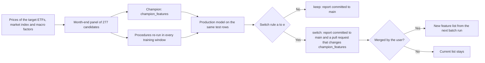

# ETF Predictor
[](https://github.com/kleinnconrad/ml.prediction.etf/actions/workflows/update_etf_seed.yml)
[](https://github.com/kleinnconrad/ml.prediction.etf/actions/workflows/manual_batch.yml)
[](https://github.com/kleinnconrad/ml.prediction.etf/actions/workflows/variable_review.yml)
[](https://github.com/kleinnconrad/ml.prediction.etf/actions/workflows/ci.yml)

This repository ranks Xetra-listed ETFs by their estimated probability of a gain of at least 10% over the next 126 trading days (about 6 months). One pooled cross-sectional logistic regression is fitted on the month-end rows of all target ETFs. Its inputs are a fixed set of price features (the champion set), ranked against the other ETFs on the same date. The top 10% of the daily ranking are `Up`, all other ETFs `Not Up`. A quarterly variable review tests whether a different feature set, chosen from 277 candidates by ANOVA-filtered stepwise selection and other fixed procedures, ranks the ETFs better; a switch is proposed as a pull request only if a strict switch rule holds.

> **Portfolio Hedging:** If you are looking for a way to hedge the portfolio generated by this engine, check out the companion repository: [](https://github.com/kleinnconrad/ml.prediction.depothedging)

## Table of Contents

- [Motivation for ETF Ranking](#motivation-for-etf-ranking)
- [Folder Structure](#folder-structure)
- [From Per-ETF Models to One Pooled Model (2.0.0)](#from-per-etf-models-to-one-pooled-model-200)
- [Model Architecture](#model-architecture)
  - [1. Target](#1-target)
  - [2. Champion Features and Within-Date Ranks](#2-champion-features-and-within-date-ranks)
  - [3. Eligibility](#3-eligibility)
  - [4. Pooled Logistic Regression](#4-pooled-logistic-regression)
  - [5. Walk-Forward Validation and Model Gate](#5-walk-forward-validation-and-model-gate)
  - [6. Ranking and Up Decision](#6-ranking-and-up-decision)
- [Quarterly Variable Review](#quarterly-variable-review)
  - [Candidate Pool](#candidate-pool)
  - [Selection Procedures](#selection-procedures)
  - [Evaluation and Switch Rule](#evaluation-and-switch-rule)
  - [Repeated Reviews](#repeated-reviews)
- [Expected Performance and Limitations](#expected-performance-and-limitations)
- [Configuration (`config/settings.yaml`)](#configuration-configsettingsyaml)
- [Data Source](#data-source)
- [Target ETF List](#target-etf-list)
- [Outputs](#outputs)
- [Automated Workflows](#automated-workflows)
- [Execution (Local & Development)](#execution-local--development)
- [Dependency Management](#dependency-management)
- [Continuous Integration](#continuous-integration)
- [Release Process](#release-process)
- [Cloud Deployment (Docker)](#cloud-deployment-docker)

---

## Motivation for ETF Ranking

* **Broad baskets instead of single companies:** An ETF holds a cross-section of assets, so company-specific events (earnings, lawsuits) are diversified away. What remains are the price dynamics of markets, sectors, regions and asset classes.
* **Ranking instead of timing:** The model does not forecast whether the market rises. It compares the ETFs of the same date with each other and asks which of them are more likely than the others to gain at least 10% within 6 months. A one-dimensional timing forecast from a single price history has very few independent observations (see [From Per-ETF Models to One Pooled Model (2.0.0)](#from-per-etf-models-to-one-pooled-model-200)); a cross-section of about 150 ETFs per month-end has many more.
* **One model for all ETFs:** ETFs that track the same index behave alike, so they get the same model and, for the same inputs, the same probability.

---

## Folder Structure

- **`.github/`**: GitHub Actions workflows (seed update, batch run, quarterly variable review, pre-merge checks, release process) and the Dependabot configuration.
- **`artifacts/`**: Persisted outputs: `latest_batch_results.json` (the batch report read by the dashboard), `history/` (a compact archive of every batch report), `uplift_report.json` (the realized returns of the archived predictions) and `variable_reviews/` (the reports of the quarterly variable reviews). Older files come from the per-ETF models before release 2.0.0.
- **`config/`**: `settings.yaml` (all model, review and download parameters), the target list `batch_targets.json`, the ETF seed list and the Xetra T7 instrument dump.
- **`devcontainer/`**: Configuration for reproducible development environments.
- **`docs/`**: Supplementary documentation: feature engineering details and the GLM checklist.
- **`scripts/`**: Target list curation (Xetra T7 download, seed generation, liquidity screening) and the entry point of the quarterly variable review.
- **`src/`**: Core logic: settings, price download, features, pooled model, variable review, batch report, command line entry point and Streamlit app.
- **`tests/`**: Offline tests (pytest) on synthetic price data.
- **`utilities/`**: Auxiliary tools such as the return on investment calculator.
- **`index.html`**: Dashboard of the latest batch report.

---

## From Per-ETF Models to One Pooled Model (2.0.0)

Release 2.0.0 replaces the per-ETF models (one model per target ETF, about 300-400 macro variables, ANOVA pre-filter and stepwise selection per ETF, three classes from absolute return thresholds) with one pooled ranking model. The numbers in this section come from tests run on 2026-11-08, before the release. Their scripts are not part of the repository.

| | Up to 1.6 | From 2.0.0 |
|---|---|---|
| Models | One per target ETF (about 156) | One for all target ETFs |
| Training data per model | One ETF's daily rows over about 7.5 years (about 1,900 rows, about 15 non-overlapping 6-month outcomes) | All ETFs' month-end rows over up to 10 years (about 17,500 rows on 114 month-ends, about 150 ETFs per date) |
| Inputs | About 300-400 macro series (FRED and Yahoo Finance), the same for every ETF on a date | A fixed champion set of 9 price features of each ETF, ranked against the other ETFs on the same date |
| Feature selection | ANOVA pre-filter (80) and stepwise selection (12), per ETF and per run | None in production; a quarterly champion-challenger review with a switch rule |
| Target | Down / Flat / Up by absolute thresholds (Down: below +1.2% in 6 months) | Gain of at least 10% in 126 trading days |
| Decision | Kolmogorov-Smirnov cutoff for Down, fixed 65% hurdle for Up | Top 10% of the daily ranking, if the model passes its validation gate |
| Validation | Out-of-fold accuracy on the folds that also selected the features | Yearly walk-forward refits, per-date AUC with a block-bootstrap interval |

**Why the per-ETF design was replaced:**
- **The reported accuracy was not an out-of-sample estimate.** The ANOVA filter used all labels, the stepwise selection chose the features on the same folds that later produced the out-of-fold accuracy, and the down cutoff was tuned on the predictions it was scored on.
  - On 20 synthetic targets without any predictable component, the pipeline reported an average out-of-fold accuracy of 69.8% and passed its quality gate in 20 of 20 runs. The batch of 156 real ETFs reported 70.1% on average.
  - Re-running the whole selection inside each training fold (walk-forward) gave 40.3% for 9 real ETFs, against 55.2% for a constant forecast of the most frequent class; 8 of the 9 ETFs were below that constant forecast.
- **Overlapping outcomes.** A daily row and the next share 125 of their 126 forward days. The ANOVA F-test counts every row as independent: on the targets without information, 89% of the features were "significant" at 5%.
- **Unstable selections.** Of 149 pairs of ETFs that track the same index (daily return correlation above 0.995), 34% received different classes, for example Up for one share class of the Xtrackers Euro Stoxx 50 and Down for the other.
- **Data defects.** FRED observations whose 30-day publication shift fell on a Xetra holiday or weekend were dropped (39% of the monthly observations; the weekly NFCI completely), and the uniform 30-day lag was shorter than the release delay of most monthly series.
- **Absolute thresholds per ETF.** Money-market ETFs never reached the Up threshold; their class followed the interest rate known at prediction time, which produced accuracies of 95-99%.

---

## Model Architecture

The model is implemented in `src/modeling.py`; the features in `src/features.py`; the price download in `src/prices.py`. All parameters are read from `config/settings.yaml`.

### 1. Target

An ETF is a positive case on date t if its adjusted close 126 trading days later (`horizon_days`, counted in the ETF's own trading days) is at least 10% (`threshold`) above its close on t, point to point. The label of a row is known once that later close exists (`label_end`).

### 2. Champion Features and Within-Date Ranks

Every feature is computed per ETF on its own trading days from trailing windows only:

| Feature | Definition |
|---|---|
| `ret_21`, `ret_63`, `ret_126` | Return over 21, 63 and 126 trading days: `close[t] / close[t-k] - 1` |
| `mom_12_1` | 12-month momentum without the latest month: `close[t-21] / close[t-252] - 1` |
| `dist_sma50`, `dist_sma200` | Relative distance to the 50- and 200-day simple moving average: `close / SMA - 1` |
| `vol_21`, `vol_126` | Standard deviation of the daily returns over 21 and 126 trading days |
| `drawdown_252` | Relative distance to the 252-day high: `close / max(close over 252 days) - 1` |

The list is `champion_features` in `config/settings.yaml`; `champion_adopted` records the date on which it was adopted. On every month-end, each feature of the eligible ETFs is converted to its percentile rank among the eligible ETFs that have a value, minus 0.5, so every model input lies between -0.5 and 0.5 and a median ETF has 0. An eligible ETF without a value gets the neutral rank 0. Because the inputs are ranks within a date, a series with the same value for every ETF on a date (such as a macro indicator) cannot enter the model directly; the review pool contains each ETF's exposure to macro factors instead (see [Candidate Pool](#candidate-pool)).

### 3. Eligibility

The rows of all ETFs are placed on the union calendar of their trading days; a day without a trade carries the ETF's last trading day for at most 5 days (`ffill_limit_days`). An ETF is ranked on a date if it has at least 253 own trading days up to the date (`min_history_days`), a positive 126-day traded value, a price above 1 EUR (`min_price_eur`) and a last trade at most 5 days old.

### 4. Pooled Logistic Regression

One L2-regularized logistic regression (`model_l2_c` = 0.1, lbfgs, no class weights) with one intercept and one coefficient per feature is fitted on the month-end rows of all ETFs whose labels are known, from the last 10 years (`model_history_years`). The ETF does not enter the model: two ETFs with the same feature ranks get the same probability.

### 5. Walk-Forward Validation and Model Gate

Every run recomputes a walk-forward validation. Each of the last 8 calendar years (`validation_years`) is scored by a model refitted on the rows whose forward return ended before the first test month-end of that year, so no training label overlaps the test period. For every test month-end the cross-sectional ROC AUC is computed (dates with at least 30 ETFs and both classes, `min_etfs_per_date`). The mean over all test dates gets a moving-block bootstrap interval (blocks of 6 month-ends, 2000 replications). If the lower bound of the 95% interval is not above 0.5 (`min_validation_auc_lower`), the gate fails and no ETF is Up.

### 6. Ranking and Up Decision

On the scoring date (the last closed trading day), the eligible ETFs are ranked by probability (ties by ticker). The top `round(0.10 x n)` of the ranking (`up_share`, at least one ETF) are `Up` if the gate passed; all other ETFs are `Not Up`. The batch report lists, per ETF, the probability, the rank, the feature percentiles and the contribution of each feature to the log-odds relative to a median ETF (coefficient x rank value).

---

## Quarterly Variable Review

Every three months, the workflow `Pipeline: 3. Quarterly Variable Review` (`scripts/review_variables.py`, `src/variable_review.py`) checks whether a different feature set ranks the ETFs better than the current `champion_features`. A challenger replaces the champion only if the switch rule holds and only after the user merges the pull request that the workflow opens. Nothing switches without that merge.



### Candidate Pool

The pool is `review_candidate_features` in `config/settings.yaml`, grouped by family. Every name refers to a feature of the registry in `src/features.py`; a test requires the list to contain every registered feature. Change the pool deliberately before a review, not in response to the results of one.

| Family | Features | Contents |
|---|---|---|
| Returns | 10 | Returns over 1 to 252 trading days |
| Momentum | 8 | Momentum with a skip window (12-1, 12-2, 12-3, 9-1, 6-1, 3-1, 12-6, 24-12 months) |
| SMA distance, crossovers, slopes | 23 | Distance to SMAs (10 to 250), SMA crossovers, SMA slopes |
| Highs and lows | 29 | Distance to highs and lows, range position, days since extremes, maximum drawdown, Ulcer index |
| Volatility and range volatility | 37 | Return volatility, downside and upside volatility, volatility ratios, Parkinson, Garman-Klass |
| Higher moments | 20 | Skewness, kurtosis, extreme daily returns |
| Market-relative | 26 | Beta, correlation, idiosyncratic volatility, residual momentum and relative return against EUNL.DE |
| Liquidity and volume | 28 | Traded value, Amihud illiquidity, zero-return and zero-volume shares, volume trends |
| Trend quality, overnight and intraday, oscillators, seasonality | 56 | Trend R-squared and t-statistic, up-day share, RSI, stochastics, MACD, Bollinger, CCI, MFI, ADX, same-month returns |
| Macro exposure | 40 | Per macro factor (euro-dollar, US 10-year yield, Brent oil, gold, copper, credit spread HYG-LQD, VIX, emerging markets): the ETF's beta over 126 and 252 days, and the 252-day beta times the factor change over 21, 63 and 126 days |

A macro factor has the same value for every ETF on a date; its information enters through each ETF's sensitivity to it. On one date the exposure-momentum feature orders the ETFs by their beta when the factor has risen and in reverse order when it has fallen. The betas use 5-day changes, and each factor close is the last one dated before the ETF's trading day, because the US and global markets close after Xetra.

### Selection Procedures

Each procedure maps the training rows of a window (month-end rows, within-date ranks, labels) to a feature list; the production model is then fitted on that list.

| Procedure | Selection |
|---|---|
| `stepwise` | ANOVA pre-filter (`review_anova_k` = 40), refitted inside every inner training split, and forward selection on the mean per-date AUC of inner validation blocks with a label-end purge. It stops when no addition raises that AUC by at least 0.002 (`review_stepwise_min_gain`) or at 15 features (`review_max_features`). |
| `lasso` | L1 logistic regression over the pool; the penalty is chosen from `review_lasso_c_grid` on the same inner splits, and the production model is refitted on the nonzero coefficients (at most 40). |
| `fm_screen` | Per-date rank correlation of each candidate with the label; kept if the absolute Newey-West t-statistic (6 lags) of its mean exceeds 3.0. |
| `all_candidates` | The whole pool without selection, as a reference. |
| `manual:<name>` | Fixed lists from `review_manual_sets`; none by default. |

### Evaluation and Switch Rule

The review uses the protocol of the production validation: yearly test blocks over the last 8 calendar years, training rows whose label ended before the first test date, at most 10 years of them, and test rows with known labels. Every procedure re-runs inside every training window, so the comparison includes the optimism of the selection itself. All lists are scored with the production model on exactly the same test rows; d is the per-date AUC of a challenger minus that of the champion.

A challenger qualifies if all of these hold:

| Condition | Threshold |
|---|---|
| (a) Historical mean d | at least 0.015 (`review_auc_hurdle`) |
| (b) Lower bound of the block-bootstrap interval of d at the level 1 - 0.05 / m_cum | above 0 |
| (c) Test years with a positive mean d | at least 6 (`review_min_winning_years`) |
| (d) Fresh evidence: test dates after `champion_adopted` | once 6 exist, mean d at least 0 and a top-share hit rate not below the champion's |
| (e) Top-share hit rate on all test dates | not below the champion's |

Its final list must also differ from the champion. If several challengers qualify, the largest corrected lower bound wins. Otherwise the decision is keep, and the report lists the conditions each challenger failed.

### Repeated Reviews

m_cum is the number of challenger comparisons made on the same history since the current list was adopted: the challengers of this review plus those of every earlier review dated after `champion_adopted`, counted from the committed reports in `artifacts/variable_reviews/`. Each further look at the same history therefore needs more evidence. A switch moves `champion_adopted` to the review date and starts a new count.

The baseline review of 2026-11-08 kept the champion. Mean per-date AUC on 87 test dates: champion 0.670, `stepwise` 0.661, `fm_screen` 0.628, `lasso` 0.617, `all_candidates` 0.590; no challenger met conditions (a), (b) and (c).

---

## Expected Performance and Limitations

- **Validation (data up to 2026-11-06):** mean per-date AUC 0.670, 95% interval [0.639, 0.717], on 87 test month-ends from 2019 to 2026. The top 10% of the ranking reached the target in 47.1% of the cases, against a base rate of 35.2%.
- **Walk-forward uplift:** on 88 test month-ends, the mean 6-month return of the top 10% was 10.0% against 6.4% for all ranked ETFs (+3.6 percentage points); the top 10% were ahead on 57 of the 88 dates. The uplift was negative in 2019 (-2.4 points) and in the test dates of 2026 (-4.9 points). The dashboard shows this backtest next to the realized returns of the published predictions (see [Outputs](#outputs)).
- **The ranking is largely a volatility ranking.** With an absolute target in a universe that mixes equity, bond and money-market ETFs, volatile ETFs reach +10% more often. A model with `vol_126` alone reached an AUC of 0.679 [0.651, 0.723], the champion without its two volatility features 0.644 [0.610, 0.685]. The median volatility percentile (`vol_126`) of the Up ETFs on the scoring date was about 90. With a relative target (beating the median ETF of the date), the champion reached 0.549 [0.509, 0.592] and `vol_126` alone 0.557 [0.514, 0.597]: over 2019-2026, the riskier ETFs also outperformed. The model therefore mainly selects ETFs with high risk and positive trends; it is not evidence of timing skill.
- **Survivorship:** the target list contains ETFs that exist today with at least 10 years of history and current liquidity. Closed or merged ETFs are missing from the history.
- **Duplicates:** several target ETFs track the same index; they get nearly the same rank, so the Up list can contain the same exposure more than once.
- **No costs:** spreads, fees and taxes are not part of the target.

---

## Configuration (`config/settings.yaml`)

All parameters are defined in `config/settings.yaml`; `src/config.py` reads them with `load_settings()`.

| Parameter | Value | Description |
|---|---|---|
| `horizon_days` | 126 | Forecast horizon in trading days |
| `threshold` | 0.10 | Minimum gain over the horizon for a positive label |
| `champion_features` | 9 features | Feature list of the pooled model |
| `champion_adopted` | 2026-11-08 | Adoption date of the list (fresh evidence and m_cum of the review start after it) |
| `up_share` | 0.10 | Share of the ranking marked Up |
| `model_history_years`, `feature_warmup_years` | 10, 2 | Training window and extra history for the feature windows |
| `validation_years`, `min_validation_auc_lower` | 8, 0.5 | Walk-forward validation years and the model gate |
| `market_index_ticker` | EUNL.DE | Market index of the market-relative candidates |
| `macro_factor_tickers` | 8 factors | Yahoo Finance tickers of the macro factors |
| `review_*` | | Candidate pool, inner splits, procedure parameters and switch rule of the review |
| `uplift_lookback_days`, `uplift_match_tolerance_days` | 1m: 30, 3m: 90, 6m: 180; 15 | Lookbacks of the uplift report and the maximum distance of an archived report from them |
| `history_retention_days` | 400 | Archived batch reports older than this are deleted |
| `min_years_history` | 10 | Minimum history of a target ETF (scripts/build_etf_batch.py) |

---

## Data Source

All prices come from Yahoo Finance (adjusted daily open, high, low, close and volume); no API key is needed. A run downloads the target ETFs, the market index and the macro factor tickers in batches of 60 with up to 3 retries for tickers without data, covering `model_history_years` + `feature_warmup_years` = 12 years. Rows dated on or after the current Europe/Berlin date are dropped, so the last row is the last closed trading day.

| Macro factor | Ticker | Change over k days |
|---|---|---|
| `eurusd` | EURUSD=X | Relative change |
| `us_10y` | ^TNX | Difference in yield points |
| `oil` | BZ=F (Brent) | Relative change |
| `gold` | GC=F | Relative change |
| `copper` | HG=F | Relative change |
| `credit` | HYG minus LQD | Difference of the relative changes |
| `vix` | ^VIX | Difference in index points |
| `em_equity` | EEM | Relative change |

The macro factors are only used by the macro exposure candidates of the review; the champion uses none of them. A missing market index or factor stops a run that needs it, instead of continuing with a silently reduced feature list.

---

## Target ETF List

**1. The Foundation: Xetra T7 Dump**
The process begins with the official "T7 All Tradable Instruments" CSV export from the Frankfurt Stock Exchange (Xetra), a snapshot of the instruments tradable on Xetra.

**2. Seed Extraction (`scripts/generate_seed.py`)**
This script parses the raw T7 dump, isolating only ETFs and ETCs traded in Euro (EUR). It maps the exchange mnemonics (e.g., `SXR8`) to their Yahoo Finance tickers by appending the Xetra suffix (e.g., `SXR8.DE`). The output is a list of approximately 3,000 tickers (`config/all_etfs_seed.list`).

**3. Liquidity and History Filter (`scripts/build_etf_batch.py`)**
This script evaluates all tickers via the Yahoo Finance API against two criteria:
* **Minimum History (10 years, `min_years_history`):** enough history for the training window of the model.
* **Liquidity (> 1 million EUR daily turnover):** the average traded value (volume x close) over the last 60 trading days.

The remaining ETFs (currently 156) are written to `config/batch_targets.json`, the target list of the batch run and of the variable review.

---

## Outputs

**Batch report (`artifacts/latest_batch_results.json`)**, written by `src/main.py` and read by the dashboard `index.html`:
- `execution_time`, `scoring_date`, `target` (horizon and threshold);
- `model`: features and their adoption date, coefficients, intercept, training rows, cross-section counts (ranked, Up, ineligible ETFs by reason), the walk-forward validation per year and overall, the gate and the parameters;
- `validation_per_date`: AUC, top-share hit rate, base rate and the forward return of the top share minus that of all ranked ETFs per test month-end;
- `results`: one entry per ETF with `prediction_class` (1 Up, 0 Not Up), `prediction_label`, `probability`, `rank`, `n_ranked`, `top_percent`, `latest_price`, `status` (`ok`, `model_gate_failed` or `not_eligible: <reason>`), `feature_values`, `feature_percentiles` and `logit_contributions`.

**Archive (`artifacts/history/YYYY-MM/report_YYYY-MM-DD.json`)**, written by `src/main.py` after every batch run: a compact copy of the batch report, dated by the run date (Europe/Berlin), with the model essentials and the per-ETF predictions without the feature values. Reports older than `history_retention_days` (400) are deleted.

**Uplift report (`artifacts/uplift_report.json`)**, written by `src/main.py` after the archive, or by `uv run python src/uplift.py` without a batch run: for the archived reports closest to 30, 90 and 180 days ago (`uplift_lookback_days`, within `uplift_match_tolerance_days` = 15), the return of every ranked ETF from its first close on or after the report date to the latest close (adjusted closes, so distributions are included), averaged per cohort: `Up`, `Not Up` and all ranked ETFs (`baseline`). Each lookback lists the report and scoring dates, whether the gate had passed, the realized period, the mean returns, the cohort sizes and the ranked ETFs without prices; a lookback without a matching report is `null`. An empty cohort is `null`, not a 0% return.

**Dashboard uplift section (`index.html`):**
- *Live:* one bar chart per lookback (1, 3 and 6 months) with the mean return of the `Not Up` and `Up` cohorts and a dashed line for all ranked ETFs; until an archived report of that age exists, the chart reads "not enough history yet". The first report was archived on 2026-11-08; with the weekly batch runs, the 1-month chart fills from about 2026-11-23, the 3-month chart from about 2027-01-22 and the 6-month chart from about 2027-04-22.
- *Walk-forward backtest:* the 6-month return of the top share and of all ranked ETFs after every test month-end of the walk-forward validation (`validation_per_date`), with the mean uplift, the number of dates on which the top share was ahead and the uplift per year.

**Review reports (`artifacts/variable_reviews/review_YYYY-MM-DD.json` and `.md`)**, written by `scripts/review_variables.py`: the decision and its reasons, the multiple-testing correction, the paired comparison per challenger, the AUC per year, the selected features per year and the per-date tables.

---

## Automated Workflows

| Workflow | Trigger | Function |
|---|---|---|
| `Pipeline: 1. Update Seed` (`update_etf_seed.yml`) | Manual | Downloads the Xetra T7 dump, regenerates the seed list and the target list `config/batch_targets.json` |
| `Pipeline: 2. Run Batch` (`manual_batch.yml`) | Every Saturday at 05:23 UTC, and manual | Runs the pooled model (`src/main.py`) and commits `artifacts/latest_batch_results.json`, the archive `artifacts/history/` and `artifacts/uplift_report.json` |
| `Pipeline: 3. Quarterly Variable Review` (`variable_review.yml`) | 2nd of February, May, August and November, and manual | Runs the review, commits its report and, on a switch, opens a pull request that changes `champion_features` and `champion_adopted` |
| `CI: Pre-Merge Checks` (`ci.yml`) | Pull requests and pushes to `main` | Lock file, lint and tests (see [Continuous Integration](#continuous-integration)) |
| `Release: Release Please` (`release-please.yml`) | Pushes to `main` | Release pull requests and the changelog |

A pull request opened by the review workflow with the `GITHUB_TOKEN` starts its CI run only after approval (`Approve workflows to run` in the merge box). The batch runs every week because the live uplift charts need archived reports from about 1, 3 and 6 months ago (within 15 days); a Saturday run scores the Friday close.

---

## Execution (Local & Development)

Install the locked dependencies with [uv](https://docs.astral.sh/uv/) and run the entry points from the repository root:

```bash
uv sync
```

```bash
uv run python src/main.py --price-cache .price_cache
```

```bash
uv run python scripts/review_variables.py --n-jobs 4 --price-cache .price_cache --output-dir /tmp/reviews
```

```bash
uv run streamlit run src/app.py
```

- `src/main.py` writes `artifacts/latest_batch_results.json`, archives it under `artifacts/history/` and writes `artifacts/uplift_report.json`; with `--output FILE` the three outputs go to the directory of FILE instead. `--ticker T` logs the rank and the feature contributions of an ETF and adds it to the ranking if it is not a target ETF.
- `uv run python src/uplift.py` refreshes the uplift report from the archive without a batch run; it downloads the prices it needs.
- `--price-cache DIR` reads the prices from a CSV cache if it exists and otherwise downloads them and writes the cache, for repeated local runs on the same prices.
- A local review should write to another directory than `artifacts/variable_reviews/` (`--output-dir`), because the committed reports set m_cum.
- The Streamlit app runs the pooled model on demand and shows the gate, the validation, the ranking and the feature contributions of one ETF.

---

## Dependency Management

The project uses [uv](https://docs.astral.sh/uv/) with a lockfile to ensure reproducible builds.

* **Dependencies:** `pyproject.toml` declares the direct dependencies with exact versions; development tools (pytest, ruff) are in the `dev` dependency group.
* **Lockfile:** `uv.lock` pins the complete dependency tree. After changing `pyproject.toml`, run `uv lock` and commit both files.
* **Automated Updates:** Dependabot (`.github/dependabot.yml`) checks weekly for updates of the Python dependencies (`uv` ecosystem, updating `pyproject.toml` and `uv.lock` together) and of the GitHub Actions, each grouped into a single pull request.

---

## Continuous Integration

The `CI: Pre-Merge Checks` workflow (`.github/workflows/ci.yml`) runs on every pull request and on pushes to `main`:

| Job | Checks |
|---|---|
| `Lint` | `uv.lock` matches `pyproject.toml`; `ruff check`; `actionlint` (including `shellcheck`) on the workflow files |
| `Tests` | The offline tests in `tests/` on Python 3.12 and 3.14: features and their point-in-time behavior, the pooled model, the walk-forward validation and gate, the variable review and its switch rule, the price download with a mocked yfinance, the review script and the Streamlit app on synthetic data |
| `Conventional Commits` | Every commit of a pull request follows the Conventional Commits format required by Release Please (pull requests only) |
| `CI passed` | Succeeds only if all jobs above succeeded or were skipped; use it as the single required status check in the branch protection of `main` |

Run the Python checks locally before pushing:
```bash
uv lock --check
uv run ruff check .
uv run pytest
```

---

## Release Process

This repository uses [Google's Release Please](https://github.com/googleapis/release-please) to automate the versioning and release process.

* **Conventional Commits:** All commits to the `main` branch must follow the [Conventional Commits](https://www.conventionalcommits.org/) specification (e.g., `feat: add new indicator`, `fix: correct threshold`).
* **Automated Pull Requests:** The `release-please` GitHub Action monitors the `main` branch. When it detects new `feat` or `fix` commits, it opens or updates a "Release Pull Request".
* **Changelog Generation:** This automated PR compiles all new changes into the `CHANGELOG.md` file and bumps the project version accordingly.
* **Publishing a Release:** To publish a new version, merge the open Release PR into `main`. The action tags the commit, generates a GitHub Release, and resets the cycle for the next version.

---

## Cloud Deployment (Docker)

The Streamlit app can be deployed as a web service with Docker.
* The `Dockerfile` installs the locked dependencies with uv and exposes port 8501.
* No API key is needed; the app downloads the prices from Yahoo Finance when an analysis is started and caches the result for 12 hours.

[Yahoo Finance ETF overview](https://de.finance.yahoo.com/m%C3%A4rkte/etfs/top-performer/)

Copyright (c) 2026 Conrad Kleinn. All rights reserved.
