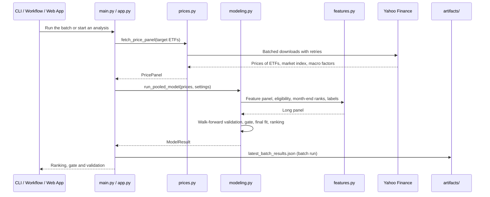

# Source Code

## Table of Contents
- [Modules](#modules)
- [Runtime View](#runtime-view)

## Modules

This directory contains the core logic of the pooled ETF ranking model. The modules import each other as top-level modules (`from config import ...`); the entry points add this directory to the Python path.

* `config.py`: Repository paths, `load_settings()` for `config/settings.yaml` and `load_universe()` for the target list `config/batch_targets.json`.
* `prices.py`: Batch download of the adjusted daily prices of the target ETFs, the market index and the macro factor tickers from Yahoo Finance with retries, and the CSV price cache.
* `features.py`: The feature registry (277 named features in 16 families, among them the macro exposure family), the eligibility rule, the within-date percentile ranks, the month-end long panel and the label.
* `modeling.py`: The pooled L2 logistic regression, the yearly walk-forward validation with the per-date AUC and its block-bootstrap interval, the model gate, the ranking with the Up decision (top `up_share`) and the per-ETF entries of the batch report.
* `variable_review.py`: The quarterly champion-challenger review of the feature set: candidate pool, selection procedures (stepwise with ANOVA prefilter, lasso, Fama-MacBeth screen, all candidates), walk-forward comparison, multiple-testing correction, switch rule, reports and the settings update.
* `reporting.py`: Logging setup, the atomic JSON writer and the batch report `artifacts/latest_batch_results.json`.
* `main.py`: Command line entry point of the batch run.
* `app.py`: Streamlit app that runs the pooled model on demand and shows the gate, the validation, the ranking and the details of one ETF.

## Runtime View

